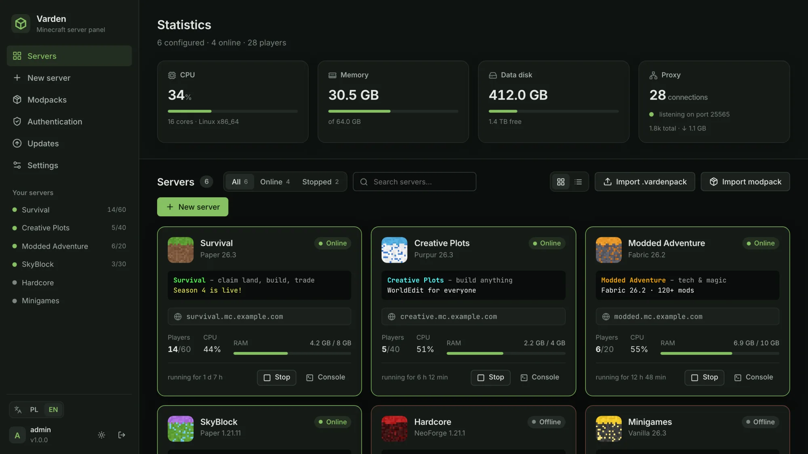
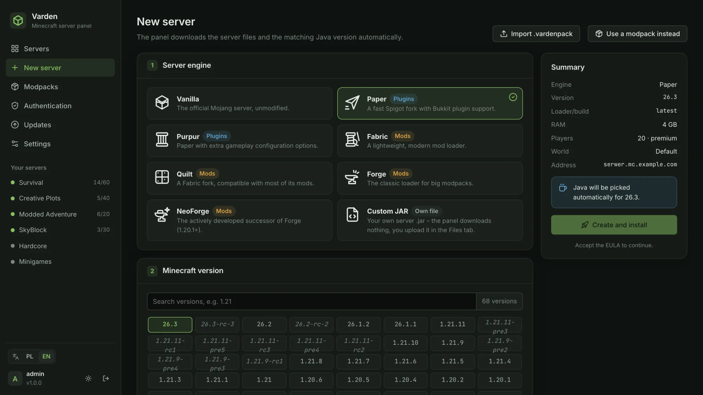
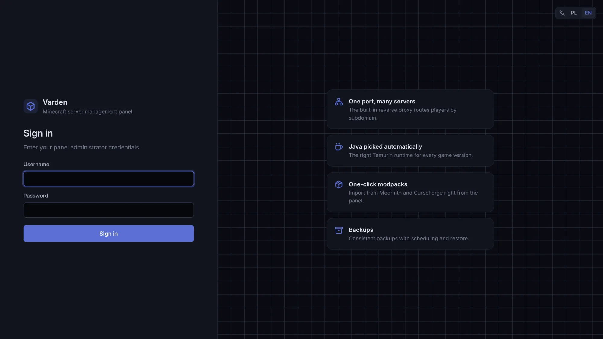

<p align="center">
  
</p>

<h1 align="center">MineNode</h1>

<p align="center">
  <b>A modern, self-hosted panel for Minecraft servers – in a single Docker container.</b><br>
  Java and Bedrock players, mods and plugins from Modrinth, live maps, backups and more – all behind one port.
</p>

<p align="center">
  <a href="LICENSE"></a>
  <a href="https://hub.docker.com/r/zzabek/minenode"></a>
  <a href="https://hub.docker.com/r/zzabek/minenode"></a>
  
  
  
</p>

<p align="center">
  <a href="#quick-start">Quick start</a> ·
  <a href="#features">Features</a> ·
  <a href="#screenshots">Screenshots</a> ·
  <a href="#documentation">Documentation</a> ·
  <a href="#open-source-projects-used">Credits</a> ·
  <a href="#license">License</a>
</p>

<p align="center">
  
</p>

> [!NOTE]
> MineNode is under active development. Back up your worlds (the panel can do it for you) before big updates.

## Why MineNode?

- **One container, one port.** Every server runs behind a single Minecraft port and gets its own address, e.g. `survival.mc.example.com`. Bedrock and voice chat also share one port each.
- **No manual downloads.** Engines, Java, mods, plugins, maps and their updates come from official sources – mostly [Modrinth](https://modrinth.com).
- **Made for friends' servers and small communities.** Non-premium players can log in safely, Bedrock players can join from phones and consoles, and everyone gets a public page with a live map.

## Features

**Servers**
- 7 engines: Vanilla, Paper, Purpur, Fabric, Quilt, Forge, NeoForge – plus any custom `.jar`
- Automatic Java: the right Eclipse Temurin version (8–25) is downloaded per server
- Creation wizard with the key settings and custom world generation (world type, seed, Terra, Iris, datapack presets)
- Live console, CPU/RAM charts, start / stop / restart / kill, autostart, crash auto-restart, daily restart
- Start on join and auto-stop when nobody is online
- `server.properties` editor, RAM and JVM flags (Aikar / ZGC), WYSIWYG MOTD editor with a server-list preview
- File manager with upload, editing, unzip and download of the whole server as one ZIP
- Whitelist (with "who tried to join"), OPs, kicks and bans

**Mods, plugins and content**
- One-click mods and plugins from Modrinth and CurseForge, with required dependencies
- Modpack import: Modrinth `.mrpack` and CurseForge
- Datapacks and resource packs from Modrinth, CurseForge or upload
- Compatibility check of every jar against the game version and loader
- **Updates tab**: update everything per server with one click or item by item. Versions always come from Modrinth, and files uploaded by players are never changed

**Players and networking**
- One shared port `25565` for all servers, routed by subdomain; several main domains and custom aliases
- **Bedrock Edition** through Geyser on one shared port `19132`
- **Simple Voice Chat** for every server through one UDP port `24454`
- **Login for non-premium servers**: a hidden [PicoLimbo](https://github.com/Quozul/PicoLimbo) lobby with `/register` and `/login`, plus session management in the panel
- **Player skins** on offline-mode servers with SkinsRestorer
- Resource packs served straight from the Minecraft port – no extra web server

**Public page and maps**
- Public stats page per server: who is online, uptime, how to join, recent chat and per-player statistics with 3D block icons
- Live web map: **squaremap**, **Dynmap** or **BlueMap** (2D or 3D), with optional player positions and a 24/7 preview while the server is off
- **Distant terrain (LOD)** for Distant Horizons and Voxy players, with light server settings
- **Chunky** world pre-generation that pauses while people play

**Backups and administration**
- Advanced backup system: scheduled, consistent backups to the panel disk, a NAS folder, S3-compatible storage or WebDAV – several at once, each with its own retention
- Portable `.minenodepack` export / import of whole servers
- Setup wizard on first start, multiple panel users, password reset from the terminal
- English and Polish interface, light and dark theme

Every feature is described in detail in **[docs/features.md](docs/features.md)**.

## Screenshots

| Dashboard | New server | Sign-in |
| :---: | :---: | :---: |
|  |  |  |

## Quick start

You need a machine with **Docker** and **Docker Compose**. Java is not needed – MineNode downloads it by itself.

**1. Create `docker-compose.yml`:**

```yaml
services:
  minenode:
    image: zzabek/minenode:latest
    container_name: minenode
    restart: unless-stopped
    ports:
      - "8080:8080"           # web panel
      - "25565:25565"         # Minecraft Java – one port for every server
      - "24454:24454/udp"     # Simple Voice Chat
      - "19132:19132/tcp"     # Bedrock Edition (Geyser)
      - "19132:19132/udp"     # Bedrock Edition (Geyser)
    volumes:
      - minenode-data:/data
    environment:
      TZ: Europe/Warsaw
    stop_grace_period: 2m     # lets servers save their worlds on stop

volumes:
  minenode-data:
```

**2. Start it:**

```bash
docker compose up -d
```

**3. Open `http://<your server IP>:8080`** and follow the setup wizard: language, administrator account, domain and ports, resource pack hosting.

**4. Point a wildcard DNS record at your server** (optional, but recommended): `*.mc.example.com  A  <server IP>`. Players then join `<server name>.mc.example.com`.

Prefer a single command?

```bash
docker run -d --name minenode --restart unless-stopped \
  -p 8080:8080 -p 25565:25565 -p 24454:24454/udp -p 19132:19132/tcp -p 19132:19132/udp \
  -v minenode-data:/data --stop-timeout 120 \
  zzabek/minenode:latest
```

**Updating:**

```bash
docker compose pull && docker compose up -d
```

**Ports to open** in your firewall and router:

| Port | Purpose |
|------|---------|
| `8080/tcp` | Web panel |
| `25565/tcp` | Minecraft Java for every server, also serves resource packs |
| `24454/udp` | Simple Voice Chat |
| `19132/tcp` + `19132/udp` | Bedrock Edition (only used when Bedrock is enabled) |

## Documentation

- **[Installation and configuration](docs/installation.md)** – compose file, setup wizard, DNS, HTTPS, backup destinations, environment variables, password reset
- **[Features in detail](docs/features.md)** – how every feature works, supported versions of the maps, Bedrock, login lobby, limitations
- **[Architecture, development and security](docs/architecture.md)** – how the panel is built, `/data` layout, running it locally, security model

## Open source projects used

MineNode stands on the shoulders of these projects – thank you to all their authors.

**Minecraft software and services**

| Project | Used for |
|---|---|
| [Modrinth](https://modrinth.com) | Mods, plugins, modpacks, datapacks, resource packs and all their updates |
| [CurseForge](https://www.curseforge.com) | Mods, plugins and modpacks (optional, with your API key) |
| [PicoLimbo](https://github.com/Quozul/PicoLimbo) by Quozul | Hidden login lobby for non-premium players (compiled from the author's release) |
| [Geyser](https://github.com/GeyserMC/Geyser) by GeyserMC | Bedrock Edition players on Java servers |
| [Eclipse Temurin](https://adoptium.net) (Adoptium) | Java runtimes for the servers |
| [Paper](https://papermc.io), [Purpur](https://purpurmc.org), [Fabric](https://fabricmc.net), [Quilt](https://quiltmc.org), [Forge](https://minecraftforge.net), [NeoForge](https://neoforged.net) | Server engines and loaders |

**Plugins and mods the panel can install for you**

| Project | Used for |
|---|---|
| [squaremap](https://github.com/jpenilla/squaremap), [Dynmap](https://github.com/webbukkit/dynmap), [BlueMap](https://github.com/BlueMap-Minecraft/BlueMap) | Live web maps |
| [Distant Horizons](https://modrinth.com/mod/distanthorizons), [LOD Server Support](https://modrinth.com/mod/lod-server-support), [Voxy](https://modrinth.com/mod/voxy) | Distant terrain (LOD) |
| [SkinsRestorer](https://modrinth.com/plugin/skinsrestorer) | Player skins on offline-mode servers |
| [Simple Voice Chat](https://modrinth.com/plugin/simple-voice-chat) | Proximity voice chat |
| [Chunky](https://modrinth.com/plugin/chunky), [C2ME](https://modrinth.com/mod/c2me-fabric) | World pre-generation |
| [ViaVersion](https://modrinth.com/plugin/viaversion), [ViaFabric](https://modrinth.com/mod/viafabric), [Fabric API](https://modrinth.com/mod/fabric-api) | Bedrock compatibility and mod dependencies |

**The panel itself**

[FastAPI](https://fastapi.tiangolo.com), [Uvicorn](https://www.uvicorn.org), [Pydantic](https://docs.pydantic.dev), [HTTPX](https://www.python-httpx.org), [psutil](https://github.com/giampaolo/psutil), [boto3](https://github.com/boto/boto3), [Pillow](https://python-pillow.org), [Vue](https://vuejs.org), [Vue Router](https://router.vuejs.org), [Vite](https://vite.dev), [Lucide](https://lucide.dev), [Tokio](https://tokio.rs), and the fonts Inter, JetBrains Mono and Pixelify Sans.

None of the game servers, plugins or mods are stored in this repository: MineNode downloads them from their official sources on your machine, and each keeps its own license.

## Authors

MineNode is made by **Bernard Wieczorek** and **Piotr Janaszak**.

Found a bug or have an idea? [Open an issue](https://github.com/minenodeweb/Minenode/issues).

## License

MineNode is open source under the **[Apache License 2.0](LICENSE)**.

In short: you may use it, modify it, build on it and share it – also commercially – **as long as you credit the authors**. Keep the [`LICENSE`](LICENSE) and [`NOTICE`](NOTICE) files (or show their contents in your documentation or about page), link back to this repository and mark the files you changed. The software comes without any warranty.

---

<sub>MineNode is not an official Minecraft product. It is not approved by or associated with Mojang or Microsoft.</sub>
