# Features in detail

[← Back to README](../README.md)

- [Server engines and Java](#server-engines-and-java)
- [Creating servers and worlds](#creating-servers-and-worlds)
- [Mods, plugins, modpacks, datapacks](#mods-plugins-modpacks-datapacks)
- [Updates tab](#updates-tab)
- [Managing servers](#managing-servers)
- [Networking: one port for everything](#networking-one-port-for-everything)
- [Resource packs](#resource-packs)
- [Simple Voice Chat](#simple-voice-chat)
- [Bedrock Edition (Geyser)](#bedrock-edition-geyser)
- [Player login for offline servers](#player-login-for-offline-servers)
- [Public server page and player statistics](#public-server-page-and-player-statistics)
- [Live web maps](#live-web-maps)
- [Services: skins, LOD, world pre-generation](#services-skins-lod-world-pre-generation)
- [Backups](#backups)
- [Portable server packages](#portable-server-packages)
- [Limitations](#limitations)

## Server engines and Java

- **7 engines**: Vanilla, Paper, Purpur, Fabric, Quilt, Forge and NeoForge. Versions and builds come live from the official APIs.
- **Custom JAR**: run any other server software (e.g. a hybrid or your own build). Varden downloads nothing: upload the `.jar` in the Files tab and it is found on start, whatever its name (pick one in *Java & startup* when there are several). The Minecraft version you choose only selects the Java runtime.
- **Automatic Java**: Varden reads the required Java version from Mojang's metadata and downloads Eclipse Temurin (8/11/17/21/25) through the Adoptium API.

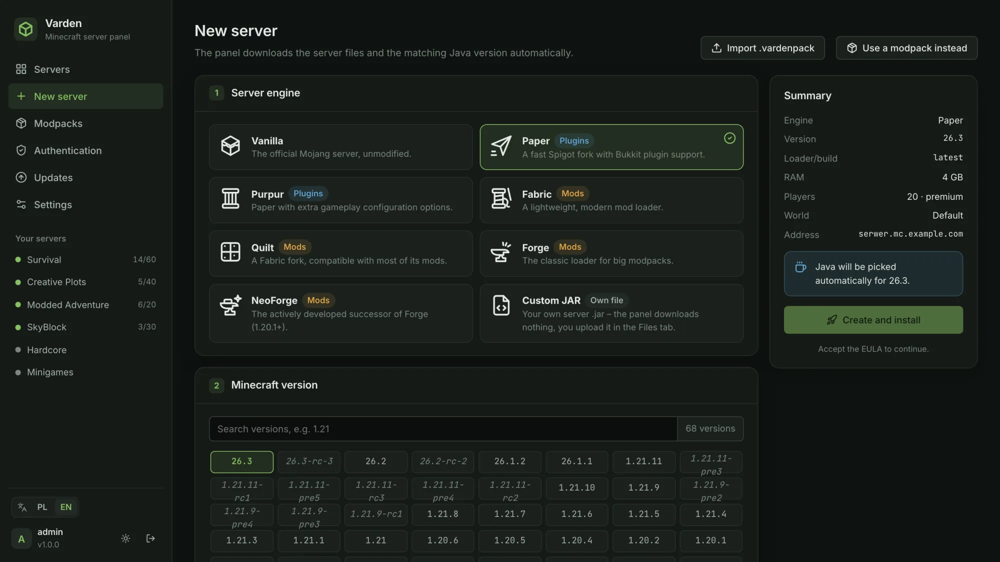

## Creating servers and worlds

- **Key settings in the creation wizard**: max players, premium-only (online-mode), login for non-premium players, whitelist, Bedrock (checked against Geyser before the server is created), game mode, difficulty, PvP, hardcore, flight, view distance, start on join and auto-stop when empty.
- **Custom world generation**: pick the world type (flat, large biomes, amplified or a datapack/mod world preset) and a seed, and add world generator datapacks, plugins (Terra, Iris…) or mods. Upload them or pick them from Modrinth's world generation category; required dependencies are downloaded automatically. Varden recognises each file, checks that it fits the engine and puts it in place before the first start (`world/datapacks/`, `plugins/` + `bukkit.yml` generator, `mods/`), so the world is generated with it from the start.

## Mods, plugins, modpacks, datapacks

- **Modpack import** from Modrinth (`.mrpack`) and CurseForge (manifest or official server pack), including uploaded files.
- **One-click mods and plugins**: search Modrinth and CurseForge filtered to the server's engine and Minecraft version. Required dependencies are installed automatically.
- **Compatibility checks**: every file in `mods/` or `plugins/` is identified on Modrinth by SHA-1 and checked against the game version and loader. Varden prints warnings about incompatible files in the console on every start.
- **Datapacks**: upload a ZIP or install from Modrinth (the version that matches the server). Varden checks that the file is a datapack (not a resource pack, plugin or mod), fixes packs wrapped in a folder, and puts it in `<world>/datapacks/`. Packs can be disabled without deleting them (they are moved out of the world) and take effect after a restart.
- **Add-ons tab**: everything you add on top of the server in one place, split into sub-tabs – *Plugins/Mods*, *Resource packs*, *Datapacks* and *Services*.

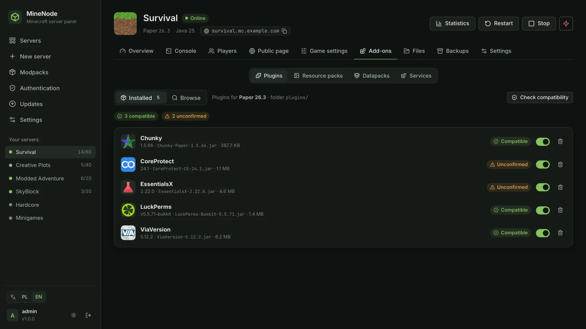

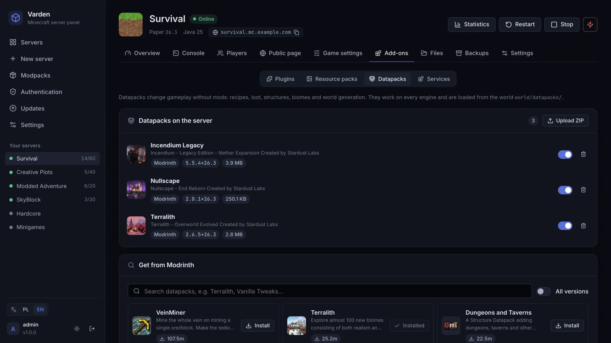

## Updates tab

One place for everything that can be updated.

- **Panel components**: Geyser (update now; stable or a pull-request test build), the Bedrock router extension and PicoLimbo, with their installed and newest versions. The last two are built into the Docker image and update with a new image.
- **Servers**: every server with an **Update all** button and an expandable list with an **Update** button next to each plugin/mod, datapack and resource pack that has a newer version.
- New versions always come from **Modrinth** and must be tagged for the server's exact Minecraft version and loader. A Paper plugin is only offered Paper builds (never a Spigot build), and a release is never replaced by a beta or alpha.
- A plugin installed from CurseForge is replaced by its Modrinth version when Modrinth has the same file.
- **Files uploaded by hand and files from a modpack are listed but never changed.** Disabled files stay disabled, and an updated resource pack that players were being sent stays active (with the same "required" setting and prompt).

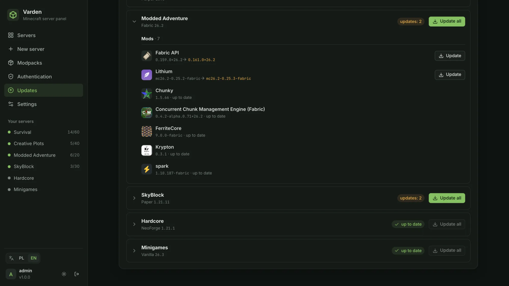

## Managing servers

- **Live console** (WebSocket) with ANSI colours, command history, filtering and WARN/ERROR highlighting.
- **Monitoring**: process CPU and RAM (15-minute charts), online players, host resources and the container memory limit.
- **Lifecycle control**: start, graceful stop, restart and kill. Also autostart, crash auto-restart with backoff, start on join, a daily restart, and **auto-stop when nobody is online**.
- **Point-and-click configuration**: a `server.properties` editor, RAM and JVM flags (Aikar / ZGC) with a live startup command preview.
- **WYSIWYG MOTD editor**: bold, italic, underline, strikethrough, `§k`, the 16 Minecraft colours, special characters and undo/redo. It includes a server-list preview (with animated `§k`) and a raw `§` code mode.
- **Custom offline/starting appearance**: set the MOTD, version label and kick messages for stopped, starting and waking servers, with `{name}`, `{motd}`, `{address}`, `{mc_version}` and `{join_hint}` placeholders.
- **Players**: a whitelist that lists players who tried to join without being on it (add them in one click), OP with a permission level, kick, ban and pardon.
- **File manager**: browse, edit text files, drag-and-drop upload, unzip, and **download every server file as one ZIP** (streamed, no temporary files).
- **English and Polish UI**: switch the language in the sidebar or on the login screen.

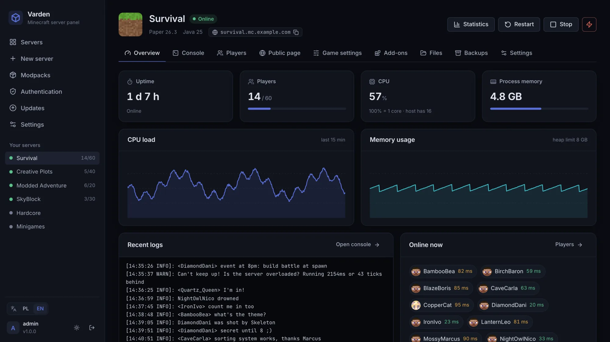

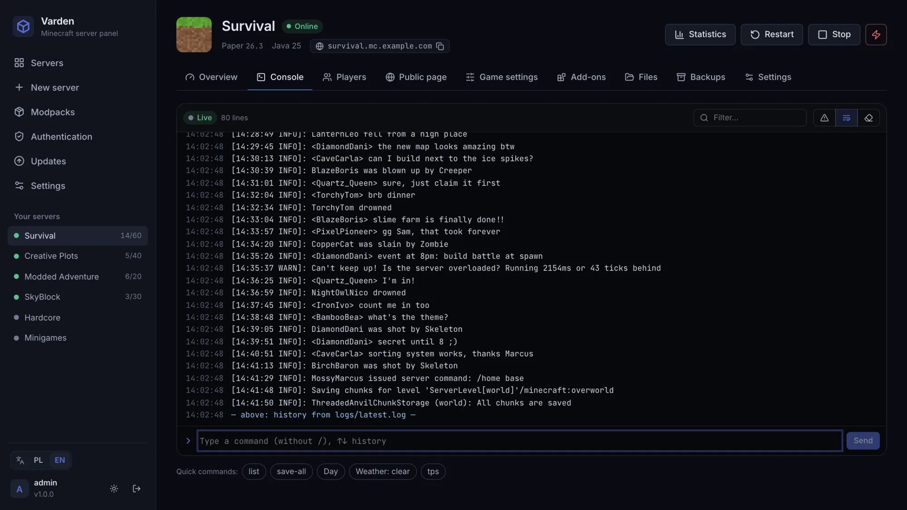

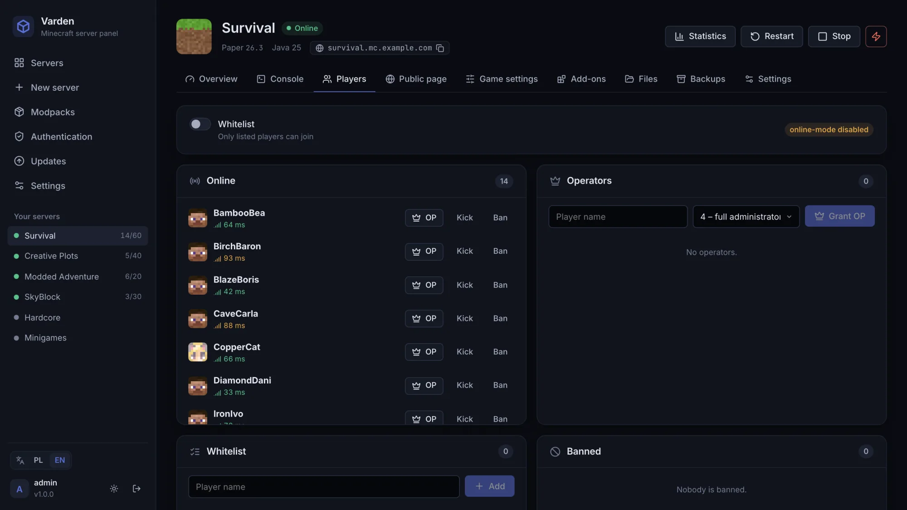

## Networking: one port for everything

Every server runs behind one port (`25565`), and players land on the right one by subdomain (`survival.mc.example.com`, `creative.mc.example.com`, …). The proxy is written in Rust (`tokio`). Several main domains and per-server aliases are supported – see [DNS and subdomains](installation.md#dns-and-subdomains).

## Resource packs

Upload a ZIP or get a pack from Modrinth/CurseForge. Varden validates `pack.mcmeta` (and fixes packs wrapped in a folder) and writes the URL and SHA-1 into `server.properties` with one click.

Players download packs straight from the Minecraft port: `http://packs.<base domain>:25565/rp/<server>/<token>/<id>.zip`. The proxy recognises plain HTTP requests on the game port, so no extra port or web server is required. The subdomain (`packs` by default) is configurable in **Panel settings**. If you prefer to serve packs through your own HTTPS reverse proxy, set the *custom resource pack host* there.

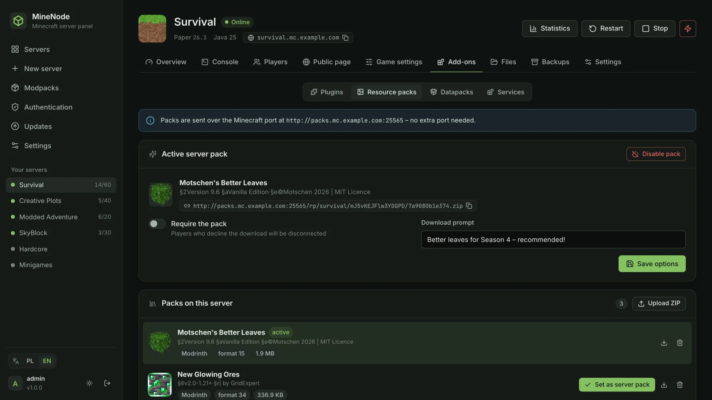

## Simple Voice Chat

Open **Server → Add-ons → Services** and click *Install & enable*. Varden:

- installs Simple Voice Chat from Modrinth (mod or plugin, matching the engine);
- gives the server a private internal voice port and binds it to `127.0.0.1`;
- sets `voice_host` to `<server address>:24454`, so clients connect to the shared proxy.

The proxy reads the player UUID at the start of every SVC packet and forwards it to the server that player is on. Open UDP `24454` on your firewall.

## Bedrock Edition (Geyser)

Varden can expose selected servers to Minecraft Bedrock Edition (phones, consoles, Windows) through Geyser Standalone, using one shared Bedrock port (`19132` by default).

1. Open **Server → Add-ons → Services → Bedrock Edition (Geyser)** and enable *Share via Bedrock* for the servers you want. Geyser is enabled independently of the Java proxy and does not affect it.
2. Open **TCP and UDP** port `19132` on your firewall and router. NetherNet uses TCP signalling and UDP gameplay on the same port.
3. Players add a server in Bedrock with the same address Java players use, e.g. `survival.mc.example.com`, port `19132`. The address must resolve on the player's device; Bedrock has no SRV records.
4. Set **Public address** in the panel settings (or *Address advertised to Bedrock players*). After finding the server, Bedrock opens the game connection to the address Geyser advertises. Without one, Geyser guesses the public address through STUN, and behind Docker or a home router NAT it usually picks a random port that is not forwarded: players see the server but cannot join. If no public address is set, Varden advertises a server hostname under the base domain when it resolves.

How it works: Geyser runs with `advanced.bedrock.validate-bedrock-login: false`. A bundled Geyser extension (VardenRouter) routes players by the address they entered to the same server as Java Edition. Geyser connects to the Java proxy as a normal Java client and prefixes the connection with a PROXY v2 header carrying the real Bedrock address; the proxy accepts that header only from loopback, so a public client cannot spoof its IP. Hostname routing, whitelist, *start on join*, player IPs and voice chat work exactly as for Java players.

Port `19132` is shared by every server, so there is no per-server Bedrock port to open. Disabled or incompatible servers keep their hostnames reserved: connecting to their address is rejected instead of reaching that server or landing on another one. Enabling the first server downloads Geyser and Java 21 automatically; the gateway starts when the first server enables Bedrock and stops when none do.

Varden checks the Java version supported by the current Geyser build and keeps Geyser updated from the official Downloads API. Older Paper/Purpur servers receive a managed ViaVersion plugin; Fabric servers receive ViaFabric and Fabric API. The gateway restarts by itself after a Geyser update, while Minecraft servers are not restarted. Vanilla, Forge, NeoForge and Quilt servers are blocked when they need a translator that their loader cannot provide.

**Geyser build and console**: in **Updates → Panel components**, run the stable release (default) or a *test build* from a Geyser pull request. Switching downloads the build from `download.geysermc.org` (project `geyserpreview`, SHA-256 checked) and restarts only the gateway; switching back to stable is one click. In Panel settings → *Geyser logs*, commands typed under the log go to Geyser's console. The same card can turn off Geyser's integrated resource pack (`gameplay.enable-integrated-pack`) to diagnose slow joins on weaker devices.

**Authentication:** Geyser has one global auth mode. If **any** enabled Bedrock server runs in online mode, Varden sets `auth-type: online`, and every Bedrock player must have a Java Edition account linked to their Xbox account. When all enabled Bedrock servers are offline-mode, Varden switches to `offline`, so Bedrock players do not need Java Edition. The mode is re-evaluated automatically, and only Geyser restarts when it changes. Letting Bedrock players join an online-mode server without Java Edition requires Floodgate, which Varden does not install.

For `auth-type: online`, Geyser asks Microsoft only once per saved Bedrock username. Set `VARDEN_BEDROCK_SAVED_LOGINS` to the Bedrock gamertag(s), separated by commas, then recreate the container. Geyser stores refresh tokens (not passwords) in `/data/bedrock/saved-refresh-tokens.json`. Do not expose that file or include it in public backups.

## Player login for offline servers

Varden runs one hidden, lightweight [PicoLimbo](https://github.com/Quozul/PicoLimbo) authentication lobby (written in Rust) with `/register` and `/login`, enabled per server. PicoLimbo supports clients from 1.7.2 to current releases, so the lobby needs no ViaVersion and no Java heap. Players connecting to an offline-mode server without a valid session are sent to the lobby. After logging in, the lobby disconnects them with a reconnect message, and the next connection goes to the original server. The target server does not need to be Paper and does not count lobby players in its slots.

The **Authentication** tab explains how the lobby works and lists active sessions with player names and public IPs (also the real Bedrock IP), plus all registered players. Administrators can end a session, change a player's password or remove it so the player can register again. Passwords and hashes are never displayed or returned by the API.

**Sessions** last 30 minutes from the last entry or exit and are bound to both player name and IP address; a login from another IP requires authentication again. A wrong password ends the lobby visit, and the proxy limits failed visits (10 per IP and 20 per name every 15 minutes; the name limit never locks out the address the account last logged in from). While someone is logging in under a name, nobody else can enter the lobby under that name from another address, and a lobby visit lasts at most 3 minutes. Game servers listen on `127.0.0.1` only, so the login check cannot be skipped by connecting to a server's internal port.

**Client fingerprints**: the proxy passively stores an informational fingerprint from the first 15 seconds of a connection (login and configuration, before normal gameplay): Client Information (locale, view distance, chat and skin settings, main hand), the client brand and announced Plugin Message channel names with sizes and SHA-256 digests. Gameplay packets, chat, movement and inventory data are not stored. Only stable values (protocol, brand and channel names) are used in the session hash, so changing render distance, chat mode or skin visibility does not require a new login. A changed stable fingerprint invalidates the session and requires login again.

**Where PicoLimbo comes from**: PicoLimbo by Quozul (MIT License) is **compiled during the Docker image build from the author's latest stable release**. This repository keeps no copy of PicoLimbo's source – only Varden's `/login` and `/register` module as a small patch ([`backend/app/assets/picolimbo/varden-auth.patch`](../backend/app/assets/picolimbo/varden-auth.patch)), applied in the `picolimbo` Dockerfile stage. The binary, its build metadata and PicoLimbo's license (`/app/licenses/PICOLIMBO-LICENSE`) are copied into the runtime image; no Rust toolchain is installed at runtime. A newer PicoLimbo arrives with a newer Varden image (`deploy.cmd` resolves the latest stable tag and passes `--build-arg PICOLIMBO_TAG=…`).

## Public server page and player statistics

Every server has a public page at `/<subdomain>/stats` (no login): who is online, who played recently, uptime, the server as it looks in the multiplayer list, how to join, supported LOD mods (with Modrinth links) and the last 50 chat messages. Chat is read from the server log, so it survives a panel restart, and chat text is never treated as a server event. If the owner allows it, visitors can start a stopped server with one button.

**Player statistics**: clicking a player shows their world statistics (play time, deaths, kills, distance travelled, blocks mined, items crafted, and per-item breakdowns) read from the world's `stats/` folder (Minecraft 1.13+). Stats from every world (Multiverse, Nether, End) are merged, and player names/UUIDs are kept so history survives log rotation.

Blocks are shown as shaded isometric 3D icons rendered from the actual JSON block models (slabs, fences, stairs and tinted blocks such as grass or leaves look right); items without a block model use their flat sprite. Models and textures are read in one in-memory pass from the vanilla client JAR, installed mods/plugins and the server's resource pack (which overrides vanilla/mod assets). All icons are bundled into one cached `.mnpk` pack per asset set, served with ETags.

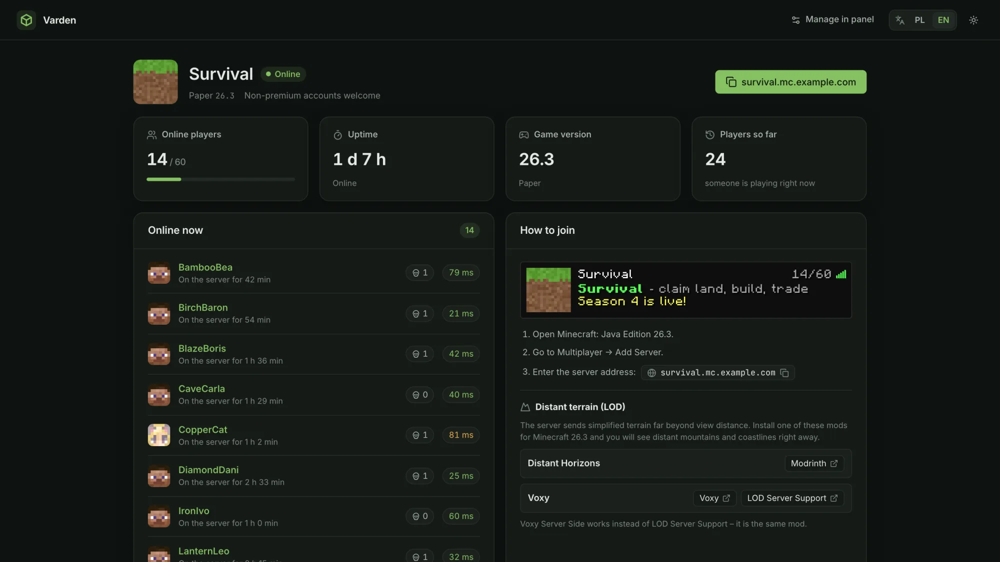

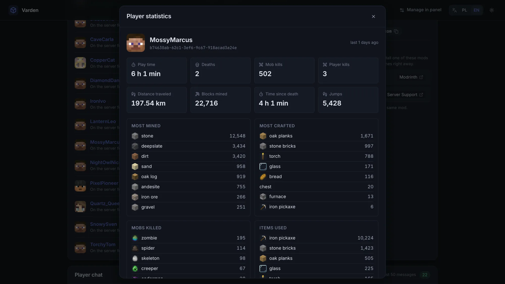

## Live web maps

Turn on a live world map for a server and it appears on its public page. Pick **squaremap** (light 2D), **Dynmap** (flat, optionally isometric) or **BlueMap** (3D, optionally flat only – the lighter default). Varden installs, updates and configures the chosen map; other maps it manages are disabled but kept on disk.

- **No extra port**: squaremap's and Dynmap's web files are served by the panel. BlueMap's files and tiles are served from disk too, and only its live data comes from BlueMap's web server on `127.0.0.1`, proxied under `/map/<server id>/` (GET only, web chat off).
- **Player positions** can be hidden.
- **Rendering**: all three maps draw new and changed chunks by themselves. Terrain from before the map was enabled is drawn by a full render that runs only when you press **Render map** (BlueMap scans the world on its own). Enabling BlueMap accepts the Minecraft EULA for BlueMap's download of client resources from Mojang.
- **Map preview 24/7** (on by default) keeps the map on the public page while the server is stopped. squaremap's web folder, Dynmap's web folder (Dynmap runs in its external-web-server mode, writing its state to JSON files the panel serves) and BlueMap's webroot with its pre-compressed tiles are served from disk, and the player list is empty until the server runs again.

| Map | Paper / Purpur | Fabric / Quilt | Forge | NeoForge |
| --- | --- | --- | --- | --- |
| squaremap | 1.19.3 – 26.3 | 1.19.3 – 26.3 | 1.19.3 – 1.20.1 | 1.20.2 – 26.3 |
| Dynmap | 1.13.2 – 26.3 (Dynmap CE from GitHub; Modrinth up to 1.21.4) | up to 1.21.11 (Modrinth), 26.1 (CE) | up to 1.21.11, 26.1 (CE) | – |
| BlueMap | 1.13 – 26.3 | 1.15.2 – 26.3 | 1.14.4 – 26.3 | 1.20.2 – 26.3 |

## Services: skins, LOD, world pre-generation

*Server → Add-ons → Services* holds optional per-server features: player login, Simple Voice Chat, Bedrock (Geyser), the public page with the live map, player skins, distant terrain (LOD) and Chunky.

- **Player skins (SkinsRestorer)**: one switch installs [SkinsRestorer](https://modrinth.com/plugin/skinsrestorer) from Modrinth (plugin on Paper/Purpur, mod on Fabric/Quilt/NeoForge; no Forge build) and keeps it updated. On offline-mode servers every player then gets the skin of the Minecraft Java account with the same name; players without one choose a skin with `/skin set <name>` or `/skin url <link>`. Bedrock players get a default or same-name Java skin, not their Bedrock skin – that needs Floodgate, which Varden does not use.
- **Distant terrain (LOD) for Distant Horizons and Voxy**: server-side LODs let players with the client mod see terrain hundreds of chunks away without exploring. Distant Horizons uses the DH mod on Fabric/Quilt/Forge/NeoForge and the *Distant Horizons Support* plugin on Paper/Purpur. Voxy uses *LOD Server Support* (Fabric/Quilt/NeoForge mod, Paper/Purpur plugin; Minecraft 1.21.1 and newer, no Forge). Varden writes light settings: a 64–512 chunk radius (DH needs at least 256), two worker threads, a few requests per player, capped bandwidth and – unless you enable *Generate missing terrain* – LODs only from chunks that already exist.
- **Chunky world pre-generation**: Varden installs the Chunky plugin or mod that matches the engine and version (with Fabric API where needed). Set the world, shape, pattern, centre and radius, then start, pause, resume or cancel with live progress (percent, rate, ETA). Generation runs only while nobody plays: it pauses when someone joins and resumes a minute after the server is empty. *Multi-core generation* raises Paper/Purpur's `chunk-system.worker-threads` to every core but one, or installs C2ME on Fabric/Quilt.

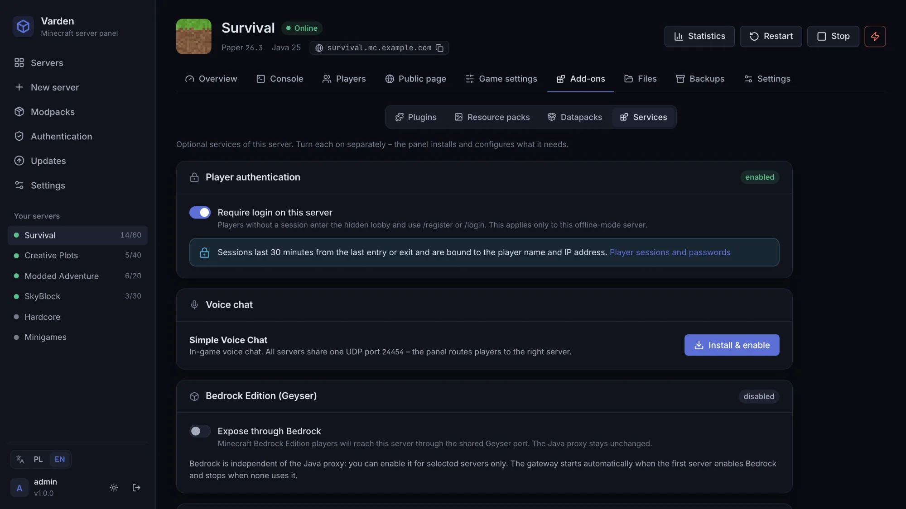

## Backups

Consistent backups (`save-off` / `save-all flush`) with scheduling and per-destination retention. Store them on the panel disk, a **mounted folder** (NAS share, second disk), **S3-compatible storage** (AWS, Backblaze B2, Cloudflare R2, Wasabi, MinIO) or **WebDAV** (Nextcloud, ownCloud, Synology) – or on several at once. Download and restore work from any of them, and a failed restore is rolled back. Setup: [Backup destinations](installation.md#backup-destinations).

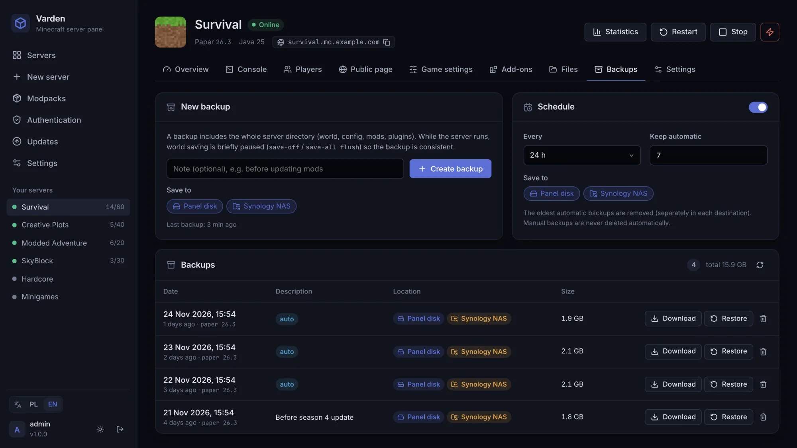

## Portable server packages

In **Server → Settings**, **Export .vardenpack** creates a portable package with the server configuration, world, installed engine, plugins/mods, resource packs, `.varden` metadata and per-server player data. The server must be stopped before export so the world is consistent. On the dashboard, **Import .vardenpack** creates a new server with a new ID and automatically allocated internal/voice ports; the original server is not overwritten. Packages contain a versioned manifest, so later Varden releases can import them. Hostnames and aliases are checked for conflicts during import.

## Limitations

- Bedrock Edition works through Geyser on one shared port. Geyser's global auth mode means that when any enabled server is online-mode, Bedrock players need a linked Java Edition account; Floodgate is not included, so Bedrock players also cannot get their own Bedrock skins.
- The pre-1.7 legacy server list ping is not routed.
- Behind the proxy, servers see players as `127.0.0.1`. To pass real IPs, enable *PROXY protocol* in the server settings and on the server side (e.g. Paper: `proxies.proxy-protocol: true`).
