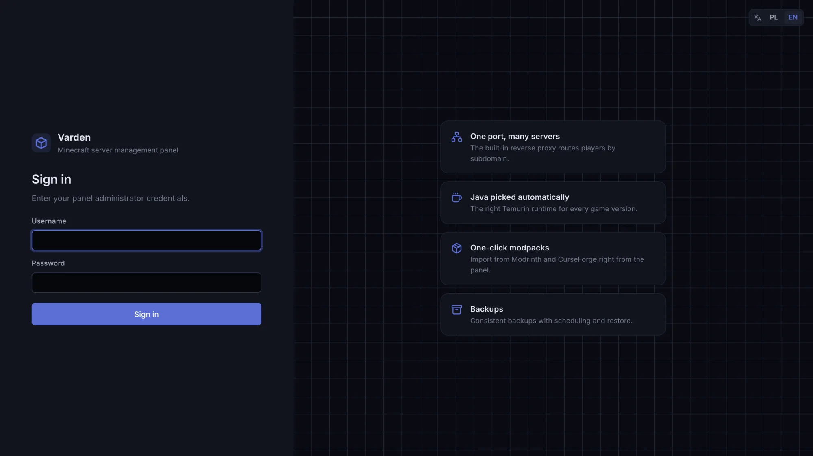

# Installation and configuration

[← Back to README](../README.md)

- [Requirements](#requirements)
- [Docker Compose](#docker-compose-recommended)
- [docker run](#docker-run)
- [First start: setup wizard](#first-start-setup-wizard)
- [Ports](#ports)
- [DNS and subdomains](#dns-and-subdomains)
- [Updating Varden](#updating-varden)
- [Upgrading from MineNode](#upgrading-from-minenode)
- [Deploying with Dockge / Portainer](#deploying-with-dockge--portainer)
- [HTTPS for the panel](#https-for-the-panel)
- [Backup destinations](#backup-destinations)
- [CurseForge](#curseforge)
- [Forgotten password](#forgotten-password)
- [Environment variables](#environment-variables)

## Requirements

- A Linux host (or any machine) with **Docker** and **Docker Compose v2**.
- Enough RAM for the Minecraft servers you plan to run (you set each server's memory in the panel).
- Ports open in the firewall and router (see [Ports](#ports)).
- Optional: a domain with a wildcard DNS record, so every server gets its own address.

Java is **not** needed on the host – Varden downloads the right Eclipse Temurin version for every server by itself.

## Docker Compose (recommended)

Create a folder with this `docker-compose.yml` (the same file is in the repository root):

```yaml
services:
  varden:
    image: zzabek/varden:latest
    container_name: varden
    restart: unless-stopped
    ports:
      - "8080:8080"           # Web panel, API and WebSocket (HTTP)
      - "25565:25565"         # Minecraft Java: one shared port for every server + resource pack downloads
      - "24454:24454/udp"     # Simple Voice Chat: one shared UDP port for every server
      - "19132:19132/tcp"     # Bedrock Edition (Geyser): NetherNet signalling
      - "19132:19132/udp"     # Bedrock Edition (Geyser): gameplay traffic
    volumes:
      - varden-data:/data
      # Optional backup destination on a NAS / second disk:
      # - /mnt/nas/minecraft-backups:/backups/nas
    environment:
      TZ: Europe/Warsaw
      PUID: "1000"
      PGID: "1000"
      VARDEN_SECURE_COOKIES: "false"   # "true" when the panel is served over HTTPS
    stop_grace_period: 2m                # time for servers to save their worlds on docker stop
    ulimits:
      nofile: { soft: 65535, hard: 65535 }

volumes:
  varden-data:
```

Start it:

```bash
docker compose up -d
```

Then open `http://<server IP>:8080` and finish the [setup wizard](#first-start-setup-wizard).

## docker run

```bash
docker run -d --name varden --restart unless-stopped \
  -p 8080:8080 -p 25565:25565 -p 24454:24454/udp -p 19132:19132/tcp -p 19132:19132/udp \
  -v varden-data:/data -e TZ=Europe/Warsaw \
  --stop-timeout 120 --ulimit nofile=65535:65535 \
  zzabek/varden:latest
```

## First start: setup wizard

There is **no default account** and nothing is read from environment variables. The first person who opens a fresh panel creates the administrator, so finish the wizard right after starting the container.

1. **Language** – the panel's default language (English by default). It also sets the default in-game texts (MOTD, version label and kick messages for stopped or starting servers). Changing the panel language later never rewrites them – edit them in *Panel settings*.
2. **Administrator account** – your own username and password.
3. **Domain and ports** – one or more main domains (you can also set them later) and a reminder to open the ports listed below.
4. **Resource packs** – the pack subdomain (`packs` by default) or your own pack hosting URL.

Until the wizard is finished, every page leads back to it. Afterwards everything can be changed in **Panel settings**.



## Ports

| Port | Purpose |
|------|---------|
| `8080/tcp` | Web panel, API and WebSocket |
| `25565/tcp` | Minecraft Java: one shared port for every server (proxy), also serves resource packs |
| `24454/udp` | Simple Voice Chat: one shared port for every server |
| `19132/tcp` + `19132/udp` | Bedrock Edition: one shared Geyser port (listens only when Bedrock is enabled on a server) |

All data (servers, worlds, Java runtimes, backups, panel config) lives in the `/data` volume.

## DNS and subdomains

1. In **Panel settings**, set the *base domain*, e.g. `mc.example.com`.
2. Add a wildcard DNS record: `*.mc.example.com  A  <server IP>` (optionally also `mc.example.com`).
3. Each server gets its own subdomain (e.g. `survival`), so players join `survival.mc.example.com`.
4. Optional: add more *main domains* (**Add domain**), e.g. `play.second-domain.net`, each with its own wildcard record. Every server then answers on all of them (`survival.mc.example.com`, `survival.play.second-domain.net`, …) for Java and Bedrock. The first domain is the default. In a server's settings (and when creating it) you pick which domain its address shows on the server card, the public page and in Simple Voice Chat. Removing a domain moves servers that showed it back to the default one. When domains overlap (`example.com` and `mc.example.com`), the longer one decides.

Connections by IP or to an unknown name go to the *default server* (set in the panel). Varden never picks one by itself – not for the first server, nor when the default server is deleted – so until you choose one, such connections are rejected. You can also attach any full domain, such as `play.myserver.net`, as an *alias* in the server settings. Bedrock players use the same hostnames on port `19132`.

## Updating Varden

```bash
docker compose pull && docker compose up -d
```

Servers save their worlds and stop gracefully when the old container stops. Your data in `/data` is kept. Plugins, mods, datapacks, resource packs and Geyser are updated from inside the panel, in the **Updates** tab.

## Upgrading from MineNode

Varden is the new name of MineNode. Your servers, worlds, backups, users and settings stay where they are.

1. In your existing `docker-compose.yml`, change only the image to `zzabek/varden:latest`. **Keep your `volumes:` section exactly as it is** – the volume name (e.g. `minenode-data`) is where your data lives; a new name would start an empty panel.
2. Run `docker compose pull && docker compose up -d`.

On the first start Varden moves everything to the new names by itself:

- `MINENODE_*` environment variables keep working and are read as `VARDEN_*` (the log reminds you to rename them).
- each server's `.minenode/` metadata folder becomes `.varden/`;
- the old Geyser extension (`MineNodeRouter`) is replaced by `VardenRouter`;
- `.minenodepack` files can still be imported;
- you stay logged in (the old session cookie is accepted).

New releases are published exclusively under `zzabek/varden:latest`; the old `zzabek/minenode` image is no longer updated.

## Deploying with Dockge / Portainer

Paste the compose file from above into Dockge or a Portainer stack. To build the image straight from GitHub instead of pulling it from Docker Hub, use a remote build context:

```yaml
services:
  varden:
    build:
      context: https://github.com/Varden-app/Varden.git#main
    image: varden:latest
    # … the rest as in the compose file above
```

## HTTPS for the panel

Put the panel behind an HTTP reverse proxy (Caddy, Traefik, nginx) with TLS and set `VARDEN_SECURE_COOKIES=true`. For example, with Caddy:

```
panel.example.com {
    reverse_proxy varden:8080
}
```

Also set `VARDEN_TRUSTED_PROXIES` to the address of that proxy (for a proxy in another Docker container, its network range such as `172.16.0.0/12`). Only those addresses may tell Varden the real client IP through `X-Forwarded-For`; anyone else could otherwise pick their own IP and get around the login attempt limit.

WebSockets work out of the box. Expose the Minecraft (`25565/tcp`), voice (`24454/udp`) and Bedrock (`19132/tcp` + `19132/udp`) ports directly – they are not HTTP.

## Backup destinations

Add destinations in **Panel settings → Backup destinations**, then pick them in each server's **Backups** tab (both for manual and scheduled backups). Every destination has a *Test connection* button that writes, reads and deletes a small file.

| Type | What to enter |
|------|---------------|
| Folder / NAS | A path **inside the container**. Mount it first, e.g. `- /mnt/nas/minecraft-backups:/backups/nas`, then use `/backups/nas` |
| S3 | Bucket, prefix, access/secret key; endpoint + region for non-AWS providers (presets included). Enable *path-style* for MinIO |
| WebDAV | Folder URL (e.g. `https://cloud.example.com/remote.php/dav/files/<user>/Backups`), username and password (use an app password in Nextcloud) |

Backups are stored as `<server-id>/<backup-id>.zip` plus a `.json` sidecar with metadata, so a destination can be browsed by hand. Large uploads to S3 use multipart transfers. Deleting a server removes only the copies on the panel disk; backups in external destinations are kept.

## CurseForge

CurseForge needs your own free API key from [console.curseforge.com](https://console.curseforge.com/). Paste it into **Panel settings** or set `CURSEFORGE_API_KEY`. Modrinth works without a key.

Some authors block API downloads of their files. Varden lists those files in the console so you can upload them to `mods/` with the file manager.

## Forgotten password

Run `reset_password.sh` from the repository on the Docker host, or inside the container:

```bash
docker exec -it varden reset_password.sh
```

It lists the panel users, asks which one to reset and prints a new random 16-character password (no look-alike characters such as `0`/`O` or `1`/`l`). Every session of that user is logged out, and the running panel picks up the change without a restart. Pass the container name and/or a username to skip the questions: `./reset_password.sh varden admin`.

## Environment variables

| Variable | Default | Description |
|----------|---------|-------------|
| `VARDEN_PORT` | `8080` | Panel port |
| `VARDEN_PROXY_PORT` | `25565` | Public Minecraft port (proxy) |
| `VARDEN_PROXY_BIN` | `/app/bin/varden-proxy` | Path to the compiled Rust transport proxy binary |
| `VARDEN_VOICE_PORT` | `24454` | Public Simple Voice Chat UDP port |
| `VARDEN_BEDROCK_PORT` | `19132` | Public Bedrock port (Geyser, TCP + UDP) |
| `VARDEN_BEDROCK_SAVED_LOGINS` | – | Comma-separated Bedrock usernames whose Microsoft login token Geyser should save and refresh |
| `VARDEN_INTERNAL_PORT_START` | `25600` | First internal game port (assigned automatically) |
| `VARDEN_INTERNAL_VOICE_PORT_START` | `24500` | First internal voice port (assigned automatically) |
| `VARDEN_INTERNAL_MAP_PORT_START` | `28100` | First loopback port for the Dynmap/BlueMap web servers (assigned automatically) |
| `VARDEN_AUTH_LOBBY_PORT` | `25999` | Loopback port of the hidden PicoLimbo login lobby |
| `VARDEN_DATA` | `/data` | Data directory |
| `VARDEN_SECURE_COOKIES` | `false` | Send session cookies over HTTPS only |
| `VARDEN_PICOLIMBO_BINARY` | `/app/bin/pico_limbo` | Path to the compiled PicoLimbo binary (override to run a custom local build) |
| `VARDEN_TRUSTED_PROXIES` | `127.0.0.1` | Reverse proxies allowed to set `X-Forwarded-For` (comma-separated IPs or CIDR ranges, e.g. `172.16.0.0/12`) |
| `CURSEFORGE_API_KEY` | – | CurseForge API key |
| `PUID` / `PGID` | `1000` | User the panel and servers run as |
| `TZ` | `Europe/Warsaw` | Time zone (daily restarts, backups) |
